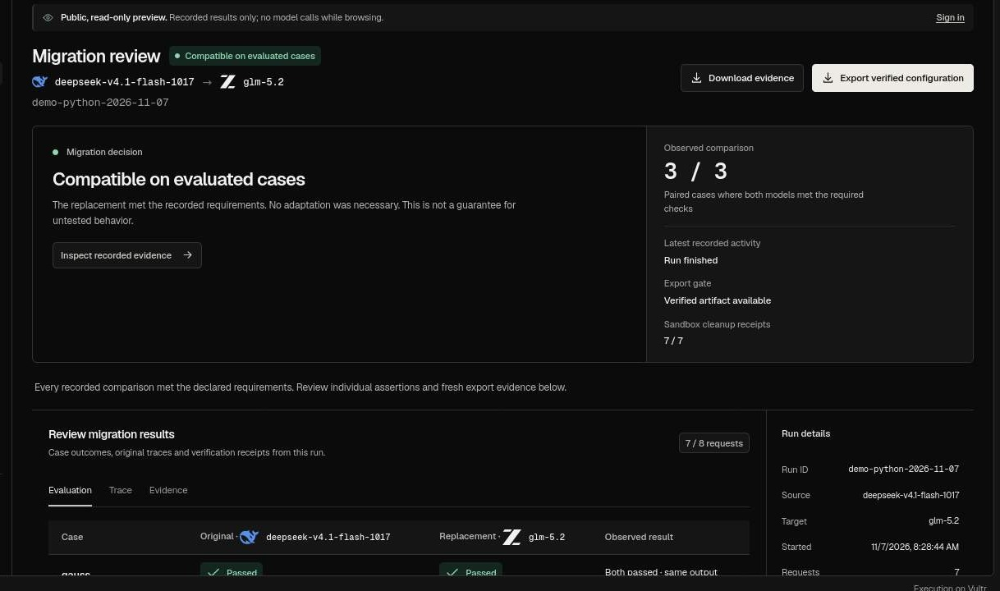

# Refit

**Change the model. Keep the behavior.**

Refit tests an existing agent before and after a model switch. It runs the original program, checks what its tools actually did, and releases a configuration only after a fresh verification run.

[**Try the live demo**](https://refit.davemafy.xyz/app) · [Watch the 2:40 film](https://github.com/Davemafy/refit/releases/download/c1-4k-4e68d190cabb/refit-vultr-challenge1-4k.mp4) · [Read the integration guide](docs/bring-your-agent.md)

[](https://refit.davemafy.xyz/app/runs/demo-python-2026-11-07)

*Recorded Python migration. Both models passed the three evaluated cases. The export passed a fresh run in the original application.*

## Try it

Open the [workspace](https://refit.davemafy.xyz/app) and choose **Run refund agent**. No sign-in or API key is required. Watch the models look up orders, apply refund policy, and call the refund tool. Refit checks the resulting order state outside the agent. The orders are synthetic. The model requests, tool execution, and sandbox cleanup are real.

To test your own application, [import a GitHub repo or ZIP](https://refit.davemafy.xyz/app/agents/new), confirm the entry point, and define the behavior that must survive the switch. Live runs have bounded capacity.

## What we verified

| Experiment | Result |
| --- | --- |
| **Refund repair** | The unchanged replacement passed **13/24** cases. With the exported patch it passed **24/24** in the original τ-bench runner, with zero unsafe attempts. [Evaluation](docs/framework-evidence-2026-11-06.md) |
| **Independent retail agent** | Both models passed **6/6** original tasks. The configuration passed **2/2** fresh checks in the original runner. [Evaluation](docs/original-retail-agent-evidence-2026-11-07.md) |
| **Imported applications** | Two browser-started Python migrations passed **3/3** per model and **1/1** fresh export check each. A pinned TypeScript AI SDK agent passed a paid migration with its original tools and file-state checks. [Python evidence](docs/bring-your-agent.md#browser-acceptance--november-7-2026) · [TypeScript evidence](https://github.com/Davemafy/refit/actions/runs/42416108155) |
| **Failed repair** | A candidate that failed independent validation was rejected and its export withheld. [Rejection receipt](docs/vultr-host-acceptance-2026-11-06.md) |

Each result applies to the linked agent, model pair, and test cases. The [engineering history](docs/engineering-history.md) and [frozen-patch evaluation](docs/vultr-frozen-patch-recovery-2026-11-06.md) cover the earlier experiments and their limits.

## Vultr Agent Rush · Blast Radius Zero

Vultr Cloud Compute hosts Refit and its disposable gVisor workers. Vultr Serverless Inference serves both migration models and the diagnostic generator. Inference credentials stay on the trusted host. Workers have no outbound network access or Docker socket, and the host verifies their removal.

In [production run `app-a0e10e54c00c4aa1`](data/evaluations/challenge1-production-diagnostic-2026-11-08.json), DeepSeek generated Python from sanitized migration evidence. Refit ran the same program in two fresh gVisor workers, including an unseen case, and checked both outputs against a trusted oracle. The diagnostic cannot authorize an export.

- [Inspect the recorded diagnostic](https://refit.davemafy.xyz/app/runs/demo-diagnostic-2026-11-08?view=evidence&observation=diagnostic) for generated code, outputs, and cleanup receipts.
- [Inspect the independent host acceptance](https://github.com/Davemafy/refit/actions/runs/42484161419) for the network, host-canary, root-write, timeout, and removal checks.
- [Download the proof bundle](https://github.com/Davemafy/refit/releases/tag/c1-4k-4e68d190cabb) or follow the [reproduction steps](docs/challenge-1-diagnostic.md).

## How it works

1. **Inspect.** Pin the source revision and identify the original entry point and model boundary.
2. **Compare.** Run both models against independent cases. Observe model calls, tool activity, and supported state changes.
3. **Verify.** Where the application exposes an approved configuration seam, test a bounded repair. Withhold exports that fail validation, holdout, or a fresh run in the original runtime.

Managed execution supports Python and pinned Node/TypeScript applications using non-streaming OpenAI-compatible Chat Completions. Developer-side connectors cover local Python and authorized loopback HTTP services. Arbitrary dependencies, custom provider protocols, and general external state verification remain outside the managed contract. [Compatibility and import limits](docs/bring-your-agent.md) · [Architecture](docs/architecture.md) · [Sandbox boundary](docs/sandbox-runtime.md)

## Run locally

Replay published evidence with Python 3.11 or 3.12, without an inference key.

```sh
git clone https://github.com/Davemafy/refit.git
cd refit
python3 -m scripts.refit_http --host 127.0.0.1 --port 8097 --runs-dir ./runs
```

Open [localhost:8097/demo](http://127.0.0.1:8097/demo). For real migrations, follow the [developer guide](docs/developer-mvp.md) and [Vultr deployment guide](docs/public-deployment.md).

[MIT License](LICENSE)
